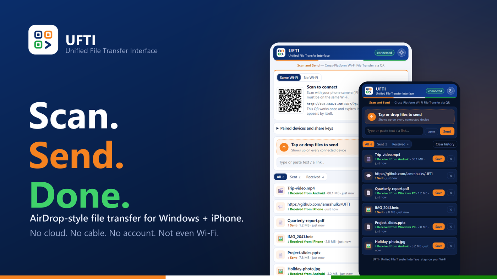
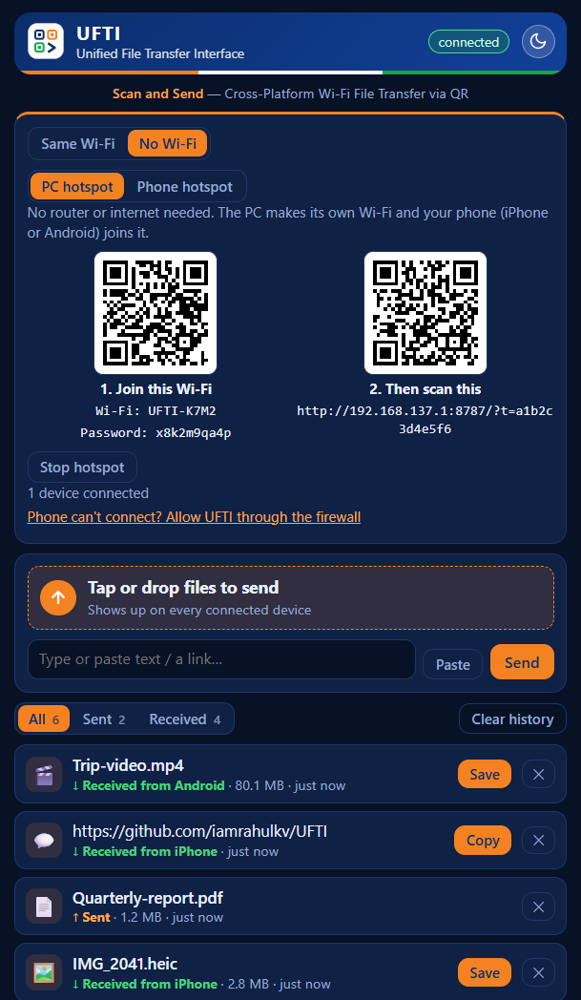

<p align="center">
  
</p>

<h1 align="center">UFTI</h1>
<p align="center"><b>Unified File Transfer Interface</b><br>
<i>Scan and Send — Cross-Platform Wi-Fi File Transfer via QR</i></p>

<p align="center">
  <a href="https://github.com/iamrahulkv/UFTI/actions/workflows/ci.yml"></a>
  <a href="https://github.com/iamrahulkv/UFTI/releases/latest"></a>
  <a href="LICENSE"></a>
</p>

Send files, photos, videos and text between your Windows 11 PC and your **iPhone or Android phone** over your own Wi-Fi, or with **no Wi-Fi at all** using a hotspot. No cloud, no account, and nothing to install on the phone. Open UFTI, scan the QR code, and send.

## Video guide
<p align="center">
  <a href="https://www.youtube.com/watch?v=qry-GdVksN8"></a><br>
  <a href="https://www.youtube.com/watch?v=qry-GdVksN8">Watch the step-by-step guide</a>: install on Windows, sideload on iPhone, connect, and transfer between iPhone and Android.
</p>

## Why UFTI
- **Private.** Data goes straight from device to device on your local network. No server in the cloud, no sign-up, no tracking.
- **One-time QR pairing.** Each phone you pair gets its own session, listed in the PC window, and you can remove it at any time. See [SECURITY.md](SECURITY.md).
- **Works with or without Wi-Fi.** Use your home network, or switch to **No Wi-Fi** and let the PC (or the iPhone) create its own hotspot. See [no-Wi-Fi guide](docs/NO-WIFI.md).
- **iPhone and Android.** The phone side is a web page, so it works in your phone's default browser, whether that's Safari, Chrome, Samsung Internet, Firefox or any other modern browser. See the [Android guide](docs/ANDROID.md).
- **Scan and send.** Scan a QR code and it opens in the phone's browser. Add it to your Home Screen for an app icon.
- **Both directions.** PC to iPhone and iPhone to PC.
- **History on both sides.** See everything you sent and received in All / Sent / Received tabs, with times. Clear it any time.
- **Any size.** Files stream straight to disk, with progress bars. A multi-GB video works.
- **Scan inside the iPhone or Android app.** Both phone apps can scan another UFTI's QR code and transfer inside the app, with no browser. The browser way always works too.
- **Phone to phone, PC to phone.** The iPhone and Android apps speak the same protocol as the Windows app, so any one can show the QR code and any other can scan it, in both directions. See the [Android app guide](docs/ANDROID-APP.md).
- **Copy without saving.** Every received file has a **Copy** button next to **Save**. Copy a photo and paste it straight into a chat, Word or Paint, with nothing saved to disk. Other files paste as files. Works the same on the PC and in the iPhone app. In a phone's browser, images can be copied too, but browsers restrict this on a local Wi-Fi link, so the iPhone app is the most reliable way to copy.
- **Text and links too.** Share a URL or a note, with one-tap copy.
- **Share button support.** Add a "Send to PC" entry to the share sheet: with a free iOS Shortcut on iPhone ([guide](docs/IPHONE-SHORTCUT.md)), or a share app such as HTTP Shortcuts on Android ([guide](docs/ANDROID.md)).
- **Compact, with light and dark themes.** A small, tidy interface that fits on one phone screen. Switch themes with the sun/moon button; it remembers your choice.
- **Lives in the tray.** Close the window and UFTI keeps listening. Optionally start with Windows.

## No Wi-Fi? Pick a mode
The **Connect** card in the PC window has two modes:

| Mode | How it works |
|---|---|
| **Same Wi-Fi** | PC and iPhone are on the same router. Scan one QR code. |
| **No Wi-Fi** | No router needed. Either the **PC creates a hotspot** (scan a QR to join it, then a QR to open UFTI) or you use your **phone's hotspot** (iPhone Personal Hotspot or Android hotspot, over Wi-Fi or USB). |

Transfers never use mobile data or the internet in either mode. Full steps: [docs/NO-WIFI.md](docs/NO-WIFI.md).

<p align="center"></p>

## Install

### Option 1: Windows installer (easiest)
1. Download `UFTI-win-Setup-x.y.z.exe` (or the no-install `UFTI-win-Portable-x.y.z.exe`) from the [latest release](https://github.com/iamrahulkv/UFTI/releases/latest).
2. Run it. If Windows SmartScreen says "Windows protected your PC", click **More info**, then **Run anyway**. The app is not code-signed yet.
3. When Windows asks about firewall access, tick **Private and Public networks** and click **Allow**.

### Option 2: Run from source
Requires [Node.js](https://nodejs.org) 18 or newer.
```bash
git clone https://github.com/iamrahulkv/UFTI.git
cd UFTI
npm install
npm run app      # desktop app
# or: npm start  # headless server, prints a QR code in the terminal
```

### Option 3: UFTI app on your iPhone
Run UFTI on an iPhone, and let an Android phone (or another iPhone) scan its QR code. The iPhone app is not on the App Store, so you install it yourself in about 15 minutes with a free Apple ID: download `UFTI-iOS-unsigned-x.y.z.ipa` from the [releases page](https://github.com/iamrahulkv/UFTI/releases) (the release named **ios-v…**), then follow the [step-by-step iPhone install guide](docs/INSTALL-IPHONE.md).

### Option 4: UFTI app on your Android phone
Run UFTI on an Android phone, and let a PC, an iPhone or another Android phone scan its QR code (or scan theirs from inside the app). Download `UFTI-Android-x.y.z.apk` from the [releases page](https://github.com/iamrahulkv/UFTI/releases) (the release named **android-v…**) and open it on the phone. See the [Android app guide](docs/ANDROID-APP.md).

## Use
1. Open UFTI on the PC. It shows a QR code.
2. Make sure the phone is on the **same Wi-Fi**, then scan the QR code with the Camera app (or Google Lens on Android) and open the link in the phone's browser. The QR code works once, and a new one appears after each scan.
3. Tap **Tap or drop files to send** on either device, or type text and press **Send text**.
4. Things you send appear on both devices instantly. Press **Save** to download, **Copy** for text.
5. Use the **All / Sent / Received** tabs to review your history. **Clear history** removes what the current tab shows, from every device, and can optionally delete the saved files from the PC too.
6. Tap the sun/moon button in the header to switch between light and dark.
7. *(Optional)* Add UFTI to the phone's Home Screen for an app-style icon (iPhone: Share, then **Add to Home Screen**; Android: browser menu, then **Add to Home screen**).

On the PC, received files are saved to `%APPDATA%\ufti\received`. Use the tray icon menu, then **Open received folder**.

The phone only needs the QR scan once. The browser remembers the pairing until you remove the device under **Paired devices and share keys**.

## Docs
- [How it works and API reference](docs/HOW-IT-WORKS.md)
- [Using UFTI with Android (browser)](docs/ANDROID.md)
- [UFTI for Android: the native app](docs/ANDROID-APP.md)
- [Using UFTI without Wi-Fi](docs/NO-WIFI.md)
- [iPhone Share button shortcut](docs/IPHONE-SHORTCUT.md)
- [Install UFTI on your iPhone](docs/INSTALL-IPHONE.md)
- [UFTI for iPhone: how the app is built](docs/IOS.md)
- [Troubleshooting](docs/TROUBLESHOOTING.md)
- [Security and privacy](SECURITY.md)
- [Contributing](CONTRIBUTING.md) and [changelog](CHANGELOG.md)

## FAQ
**Does it work over Bluetooth?** No. Apple does not let third-party apps send files to Windows over Bluetooth. UFTI uses Wi-Fi, which is also much faster.

**Does it need internet or a router?** No. Both devices only need to be on the same network, and the **No Wi-Fi** mode creates one for you with a PC or iPhone hotspot. See [docs/NO-WIFI.md](docs/NO-WIFI.md).

**Does it work with Android?** Yes. Scan the QR code with the Camera app or Google Lens and open the link in Chrome or your default browser. See [docs/ANDROID.md](docs/ANDROID.md).

**Can I use it with a Mac, an iPad or another PC?** Yes. Any device with a browser can open the pairing link.

**Is it safe on public Wi-Fi?** Not recommended. Devices pair with a one-time QR code and you can remove any of them, but traffic is not encrypted. On a network you don't trust, use the PC hotspot mode. See [SECURITY.md](SECURITY.md).

**Why isn't there an App Store or Play Store app?** A real iOS app needs a Mac and a paid Apple developer account, and the web page already works on both platforms with nothing to install. Share-sheet integration comes from an iOS Shortcut or an Android share app instead.

## Roadmap
- Code-signed Windows installer
- Auto-discovery without scanning (mDNS)
- Clipboard sync

Ideas and pull requests welcome. See [CONTRIBUTING.md](CONTRIBUTING.md).

## License
[MIT](LICENSE)
