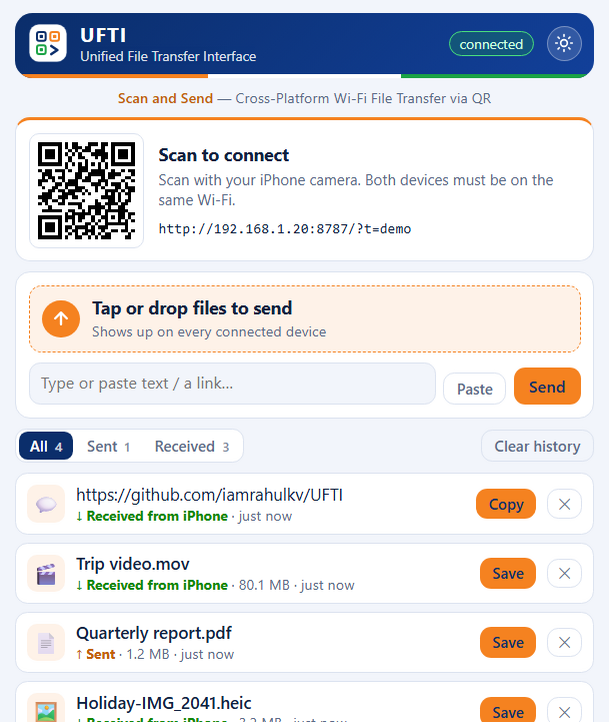
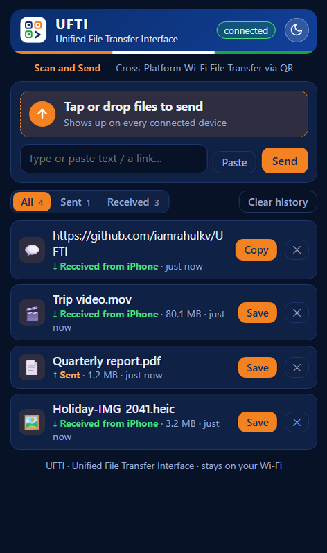
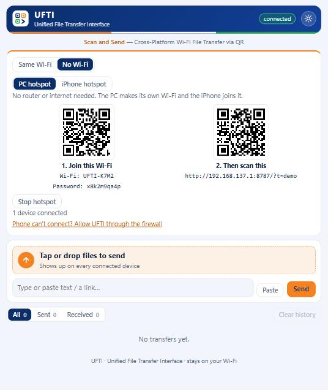

<p align="center">
  
</p>

<h1 align="center">UFTI</h1>
<p align="center"><b>Unified File Transfer Interface</b><br>
<i>Scan and Send — Cross-Platform Wi-Fi File Transfer via QR</i></p>

<p align="center">
  <a href="https://github.com/iamrahulkv/UFTI/actions/workflows/ci.yml"></a>
  <a href="https://github.com/iamrahulkv/UFTI/releases/latest"></a>
  <a href="LICENSE"></a>
</p>

Send files, photos, videos and text between your Windows 11 PC and your **iPhone or Android phone** over your own Wi-Fi, or with **no Wi-Fi at all** using a hotspot. No cloud, no account, and nothing to install on the phone. Open UFTI, scan the QR code, and send.

<p align="center">
  
  &nbsp;&nbsp;
  
</p>

## Why UFTI
- **Private.** Data goes straight from device to device on your local network. No server in the cloud, no sign-up, no tracking.
- **Works with or without Wi-Fi.** Use your home network, or switch to **No Wi-Fi** and let the PC (or the iPhone) create its own hotspot. See [no-Wi-Fi guide](docs/NO-WIFI.md).
- **iPhone and Android.** The phone side is a web page, so it works in Safari, Chrome and any modern browser. See the [Android guide](docs/ANDROID.md).
- **Scan and send.** Scan a QR code and it opens in the phone's browser. Add it to your Home Screen for an app icon.
- **Both directions.** PC to iPhone and iPhone to PC.
- **History on both sides.** See everything you sent and received in All / Sent / Received tabs, with times. Clear it any time.
- **Any size.** Files stream straight to disk, with progress bars. A multi-GB video works.
- **Text and links too.** Share a URL or a note, with one-tap copy.
- **Share button support.** Add a "Send to PC" entry to the share sheet: with a free iOS Shortcut on iPhone ([guide](docs/IPHONE-SHORTCUT.md)), or a share app such as HTTP Shortcuts on Android ([guide](docs/ANDROID.md)).
- **Compact, with light and dark themes.** A small, tidy interface that fits on one phone screen. Switch themes with the sun/moon button; it remembers your choice.
- **Lives in the tray.** Close the window and UFTI keeps listening. Optionally start with Windows.

## No Wi-Fi? Pick a mode
The **Connect** card in the PC window has two modes:

| Mode | How it works |
|---|---|
| **Same Wi-Fi** | PC and iPhone are on the same router. Scan one QR code. |
| **No Wi-Fi** | No router needed. Either the **PC creates a hotspot** (scan a QR to join it, then a QR to open UFTI) or you use your **phone's hotspot** (iPhone Personal Hotspot or Android hotspot, over Wi-Fi or USB). |

Transfers never use mobile data or the internet in either mode. Full steps: [docs/NO-WIFI.md](docs/NO-WIFI.md).

<p align="center"></p>

## Install

### Option 1: Windows installer (easiest)
1. Download `UFTI-Setup-x.y.z.exe` (or the no-install `UFTI-Portable-x.y.z.exe`) from the [latest release](https://github.com/iamrahulkv/UFTI/releases/latest).
2. Run it. If Windows SmartScreen says "Windows protected your PC", click **More info**, then **Run anyway**. The app is not code-signed yet.
3. When Windows asks about firewall access, tick **Private and Public networks** and click **Allow**.

### Option 2: Run from source
Requires [Node.js](https://nodejs.org) 18 or newer.
```bash
git clone https://github.com/iamrahulkv/UFTI.git
cd UFTI
npm install
npm run app      # desktop app
# or: npm start  # headless server, prints a QR code in the terminal
```

## Use
1. Open UFTI on the PC. It shows a QR code.
2. Make sure the phone is on the **same Wi-Fi**, then scan the QR code with the Camera app (or Google Lens on Android) and open the link in Safari or Chrome.
3. Tap **Tap or drop files to send** on either device, or type text and press **Send text**.
4. Things you send appear on both devices instantly. Press **Save** to download, **Copy** for text.
5. Use the **All / Sent / Received** tabs to review your history. **Clear history** removes what the current tab shows, from every device, and can optionally delete the saved files from the PC too.
6. Tap the sun/moon button in the header to switch between light and dark.
7. *(Optional)* In Safari, tap Share, then **Add to Home Screen**.

On the PC, received files are saved to `%APPDATA%\ufti\received`. Use the tray icon menu, then **Open received folder**.

The phone only needs the QR scan once. Safari remembers the pairing.

## The name and the look
**UFTI** stands for **Unified File Transfer Interface**. The name is inspired by India's UPI: one simple, unified way to move things between any two devices, no matter who made them. The tagline says the whole flow: *Scan and Send*.

The interface uses a palette inspired by the look of India's digital payment apps: saffron orange, India green and deep navy blue. The official UFTI logo is a QR code in three corners (navy, saffron, green) with a forward arrow taking the fourth: scan, then send. Vector source: [`docs/logo.svg`](docs/logo.svg).

> UFTI is an independent open-source project. It is **not affiliated with, endorsed by or sponsored by** NPCI, BHIM or UPI. Those names and logos belong to their owners, and UFTI does not use them.

## Docs
- [How it works and API reference](docs/HOW-IT-WORKS.md)
- [Using UFTI with Android](docs/ANDROID.md)
- [Using UFTI without Wi-Fi](docs/NO-WIFI.md)
- [iPhone Share button shortcut](docs/IPHONE-SHORTCUT.md)
- [Troubleshooting](docs/TROUBLESHOOTING.md)
- [Security and privacy](SECURITY.md)
- [Contributing](CONTRIBUTING.md) and [changelog](CHANGELOG.md)

## FAQ
**Does it work over Bluetooth?** No. Apple does not let third-party apps send files to Windows over Bluetooth. UFTI uses Wi-Fi, which is also much faster.

**Does it need internet or a router?** No. Both devices only need to be on the same network, and the **No Wi-Fi** mode creates one for you with a PC or iPhone hotspot. See [docs/NO-WIFI.md](docs/NO-WIFI.md).

**Does it work with Android?** Yes. Scan the QR code with the Camera app or Google Lens and open the link in Chrome. See [docs/ANDROID.md](docs/ANDROID.md).

**Can I use it with a Mac, an iPad or another PC?** Yes. Any device with a browser can open the pairing link.

**Is it safe on public Wi-Fi?** Not recommended. Traffic is unencrypted HTTP, protected only by a pairing token. See [SECURITY.md](SECURITY.md).

**Why isn't there an App Store or Play Store app?** A real iOS app needs a Mac and a paid Apple developer account, and the web page already works on both platforms with nothing to install. Share-sheet integration comes from an iOS Shortcut or an Android share app instead.

## Roadmap
- Code-signed Windows installer
- Optional HTTPS and a short pairing PIN
- Auto-discovery without scanning (mDNS)
- Clipboard sync

Ideas and pull requests welcome. See [CONTRIBUTING.md](CONTRIBUTING.md).

## License
[MIT](LICENSE)
