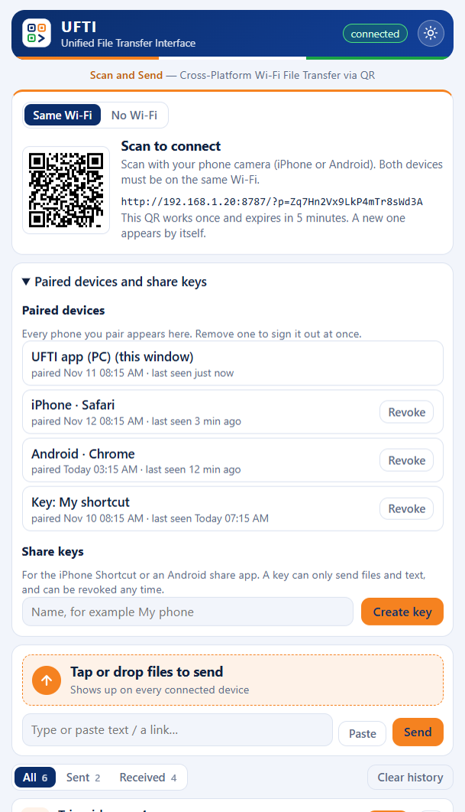

# Security and privacy

## What UFTI does
- Runs a small web server on your PC, reachable only from your local network.
- Stores received files, and a history of transfers (including shared text), on your PC. Use **Clear history** to remove them.
- Sends nothing to any third party. There is no analytics, account or cloud service.

## How access is protected

- **One-time pairing.** The QR code holds a code that works once and expires after 5 minutes. A new code appears after each scan. Scanning pairs that one device.
- **Per-device sessions.** Each paired device gets its own random 128-bit session, kept in an `HttpOnly`, `SameSite=Strict` cookie. Nothing secret stays in the address bar or browser history. UFTI stores only hashes of sessions, so a leaked `sessions.json` can't be used to sign in.
- **See and remove devices.** The PC window lists every paired device and share key. Remove one and it is signed out at once, including its live connection.
- **Share keys.** The iPhone Shortcut and Android share apps can't use cookies, so they use a share key. A key is named, shown once, revocable, and **can only send files and text**. It can't read history, download files or use any PC control.
- **Rate limiting.** More than 20 wrong attempts in a minute from one address blocks that address for a minute.
- **PC-only controls.** Hotspot, network, firewall, pairing, device and key settings answer only the UFTI window on the PC. A phone gets `403` even when it is paired.
- **Cross-site protection.** Requests that change anything must come from UFTI's own page (origin check plus the strict cookie). Requests to the PC under any other host name are refused, which blocks DNS rebinding.
- **Page hardening.** Content Security Policy, no referrer, no sniffing, no framing. File names are sanitized (no path traversal). Live updates use Server-Sent Events.

## Known limitations
- **Traffic is not encrypted.** UFTI uses plain HTTP, so on a network you don't trust (public or shared Wi-Fi) others could read files or the session cookie as they travel. Use UFTI on your home network, or use the **PC hotspot** mode (WPA2, only your own devices on it).
- **Share keys** travel in the address of each upload, so someone sniffing the network could see them. A key can only send files and text, and you can remove it any time.
- **Sessions last until removed.** The cookie lasts a year. Remove devices you no longer use. Anyone with your unlocked PC, or its UFTI data folder, can pair devices.
- **The first scan wins.** Someone who photographs the QR code and scans it before you, within 5 minutes, pairs first. Check the **Paired devices** list and remove anything you don't recognise.

## Reporting a vulnerability
Please do not open a public issue. Use GitHub's private reporting: **Security**, then **Report a vulnerability** on this repository. You will get a response as soon as possible.
