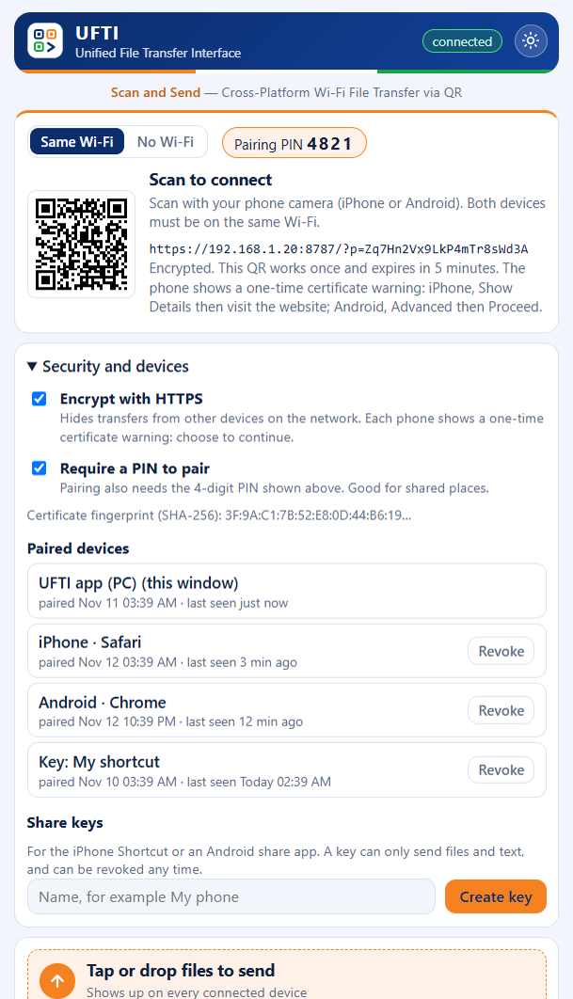

# Security and privacy

## What UFTI does
- Runs a small web server on your PC, reachable only from your local network.
- Stores received files, and a history of transfers (including shared text), on your PC. Use **Clear history** to remove them.
- Sends nothing to any third party. There is no analytics, account or cloud service.

## How access is protected

- **One-time pairing.** The QR code holds a code that works once and expires after 5 minutes. A new code appears after each scan. Scanning pairs that one device.
- **Per-device sessions.** Each paired device gets its own random 128-bit session, kept in an `HttpOnly`, `SameSite=Strict` cookie (also `Secure` over HTTPS). Nothing secret stays in the address bar or browser history. UFTI stores only hashes of sessions, so a leaked `sessions.json` can't be used to sign in.
- **See and remove devices.** The PC window lists every paired device and share key. Remove one and it is signed out at once, including its live connection.
- **Optional PIN.** Turn on **Require a PIN to pair** and a new device must also type the 4-digit PIN shown on the PC. Three wrong PINs burn the code.
- **Share keys.** The iPhone Shortcut and Android share apps can't use cookies, so they use a share key. A key is named, shown once, revocable, and **can only send files and text**. It can't read history, download files or use any PC control.
- **Rate limiting.** More than 20 wrong attempts in a minute from one address blocks that address for a minute.
- **PC-only controls.** Hotspot, network, firewall, pairing, device, key and security settings answer only the UFTI window on the PC. A phone gets `403` even when it is paired.
- **Cross-site protection.** Requests that change anything must come from UFTI's own page (origin check plus the strict cookie). Requests to the PC under any other host name are refused, which blocks DNS rebinding.
- **Page hardening.** Content Security Policy, no referrer, no sniffing, no framing. File names are sanitized (no path traversal). Live updates use Server-Sent Events.

## Encryption (optional HTTPS)
Switch on **Encrypt with HTTPS** under **Security and devices** in the PC window. UFTI creates a self-signed certificate (elliptic curve P-256, valid for 825 days, covering the PC's addresses), kept in the data folder and reused. It answers on the same port, and new QR codes use `https`. Files, cookies and everything else are then encrypted on the network.

Because the certificate isn't signed by a public authority, each phone shows a one-time warning:
- **iPhone:** Show Details, then visit this website.
- **Android:** Advanced, then Proceed.

**Speed.** On the author's PC, 1 GiB uploads written to disk ran at about 720 MB/s over HTTP and 375 MB/s over HTTPS. That is a worst case with no network in the way, and it is still several times faster than real Wi-Fi or gigabit Ethernet, so encryption does not slow real transfers.

Tools can't accept a self-signed certificate, so share-key uploads stay available over plain HTTP while HTTPS is on. Use a dedicated key and remove it when you no longer need it.

## Known limitations
- **HTTP is the default.** On a network you don't trust, switch on HTTPS, or use the PC hotspot mode (WPA2, only your devices on it).
- **Self-signed certificate.** Someone actively intercepting a connection could present their own certificate, and a phone can't tell the difference once you continue past the warning. The certificate's fingerprint is shown in the PC window so you can compare it with the one the phone displays. For hostile networks, the PC hotspot is the safest choice.
- **Share keys over HTTP** can be seen by someone sniffing the network. They can only send files and text.
- **Sessions last until removed.** The cookie lasts a year. Remove devices you no longer use. Anyone with your unlocked PC, or its UFTI data folder, can pair devices.
- **A scanned-first QR code wins.** Someone who photographs the QR code and scans it before you, within 5 minutes, pairs first. Turn on the PIN to prevent that.

## Reporting a vulnerability
Please do not open a public issue. Use GitHub's private reporting: **Security**, then **Report a vulnerability** on this repository. You will get a response as soon as possible.
