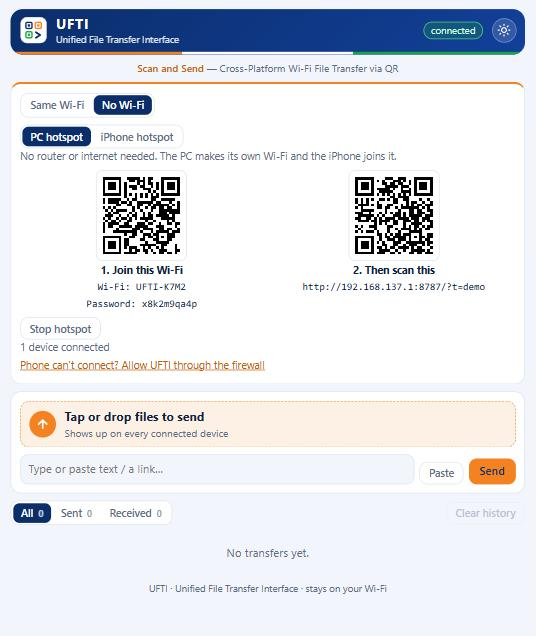

# Using UFTI without a Wi-Fi router

UFTI only needs the PC and the iPhone to share a network. A router is one way to get that, but not the only one. In the **Connect** card on the PC window, switch between:

| Mode | When to use it | What you need |
|---|---|---|
| **Same Wi-Fi** | Both devices are on the same router or network | Nothing extra |
| **No Wi-Fi, PC hotspot** | No router, and you want the PC to host | A PC with a Wi-Fi adapter that supports hotspot (most do) |
| **No Wi-Fi, phone hotspot** | No router, and you'd rather host from the phone | An iPhone (Personal Hotspot) or Android phone (Wi-Fi hotspot or USB tethering) |

The transfer itself is identical in every mode. Traffic goes straight between the two devices and uses **no mobile data and no internet**.

## Option A: PC hotspot (the PC creates the Wi-Fi, works with iPhone and Android)
1. In UFTI, open the **Connect** card and choose **No Wi-Fi**, then **PC hotspot**.
2. Press **Start PC hotspot**. Windows turns on its Mobile Hotspot.
3. **Step 1:** scan the left QR code with the phone camera and tap **Join**. (iPhone Camera and Android Camera or Google Lens can both join a network from a QR code. Or pick the network named in the card and type the password.)
4. **Step 2:** scan the right QR code. It opens UFTI in the phone's browser.
5. Send files. Press **Stop hotspot** when you're done.

Notes:
- UFTI uses the hotspot name and password already saved in Windows. It doesn't change your hotspot settings. If none are saved, it creates a name like `UFTI-K7M2` and a random password.
- Windows usually needs at least one network connection on record to start a hotspot. If you see "Windows needs one network connection to share", connect to any Wi-Fi or Ethernet once, or use Option B.
- The phone shows "No Internet Connection" under the hotspot name. That's expected. Stay connected. On Android, tap **Stay connected** when asked, and switch mobile data off if the page won't load (see [Android guide](ANDROID.md)).
- Windows can switch the hotspot off by itself when no device is connected. Turn that off in Settings, Network and internet, Mobile hotspot, Power saving.

## Option B: phone hotspot (the phone creates the Wi-Fi)
1. Turn on the phone's hotspot. Transfers don't use any mobile data, but the hotspot feature itself may need a plan that allows it.
   - **iPhone:** Settings, Personal Hotspot, turn on **Allow Others to Join**.
   - **Android:** Settings, Network, Hotspot and tethering, turn on **Wi-Fi hotspot**. Menu names vary a little by brand.
2. On the PC, choose one:
   - **Wi-Fi:** join the phone's network from the Windows Wi-Fi menu.
   - **USB cable:** iPhone: plug in, tap **Trust**, and install *Apple Devices* from the Microsoft Store if Windows doesn't recognise it. Android: plug in and turn on **USB tethering** in the hotspot and tethering settings.
3. In UFTI, choose **No Wi-Fi**, then **Phone hotspot**. It recognises the usual address ranges and shows a QR code:
   - iPhone hotspot: `172.20.10.x`
   - Android Wi-Fi hotspot: `192.168.43.x`
   - Android USB tethering: `192.168.42.x`
4. Scan the QR code with the phone camera. Done.

Some Android phones use other address ranges. If UFTI doesn't detect your phone, open **Same Wi-Fi** and pick the PC's address from the list. It works the same.

## If the phone can't open the link
Windows Firewall treats hotspot networks differently from home Wi-Fi. In the **No Wi-Fi** view, click **Phone can't connect? Allow UFTI through the firewall** and approve the Windows prompt. This adds one rule for UFTI's port on all network types. More fixes are in [Troubleshooting](TROUBLESHOOTING.md).

## What's not possible
- **Bluetooth** and **Wi-Fi Direct / ad-hoc**: iOS doesn't allow third-party apps to use them with Windows, and on Android they need a separate app on both sides.
- **A hotspot with no network at all on the PC:** Windows usually requires a network connection on record to share. The phone hotspot option avoids this.
